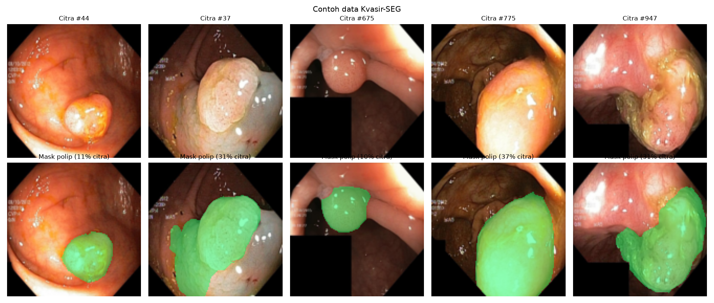
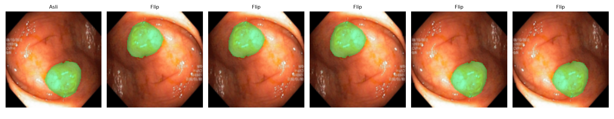
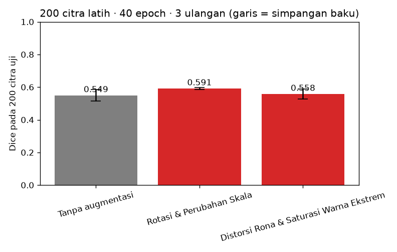
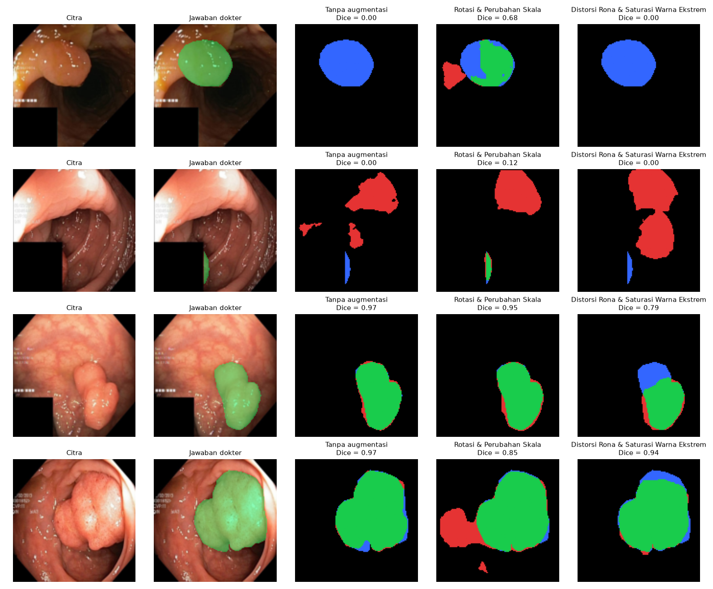

# Segmentasi Polip pada Citra Kolonoskopi dengan U-Net

<!--
  TEMPLATE LAPORAN — Tugas P10 Kecerdasan Buatan (BM25-41204), Teknik Biomedis ITERA.
  Petunjuk lengkap: https://mctm.web.id/ai-bm/tugas

  Cara memakai:
  - Ganti semua teks yang diawali "✍️" dengan tulisan kelompokmu, lalu hapus tanda ✍️-nya.
  - Blok komentar seperti ini adalah petunjuk; tidak tampil di GitHub. Boleh dihapus.
  - Gambar diambil dari folder hasil/ yang dibuat otomatis oleh notebook.
  - Jangan hapus judul-judul bagian (##).
-->

**Tugas P10 — Kecerdasan Buatan (BM25-41204), Teknik Biomedis ITERA**

## Anggota kelompok

| Nama | NIM | Username GitHub | Kontribusi utama |
|---|---|---|---|
| Rifdah Dwi Nabillah | 123430061 | rifdahdna-bm | Inisialisasi repositori, konfigurasi skenario augmentasi & hipotesis (Bagian 3), serta eksekusi eksperimen notebook |
| Suci Nurul fadhilah | 123430130 | suci280805-afk | Analisis & interpretasi hasil eksperimen (Bagian 4), pembahasan perbandingan klinis & peta kesalahan (Bagian 5), serta kesimpulan |


## 1. Pertanyaan

Augmentasi apa yang membantu U-Net menemukan polip pada citra kolonoskopi, dan augmentasi apa yang tidak? Kenapa?

## 2. Data & pengaturan

<!-- Isi dari Bagian 2 notebook. Pastikan CEPAT = False untuk hasil akhir. -->

- Dataset: Kvasir-SEG (1000 citra kolonoskopi + mask polip), diperkecil ke 128 × 128 piksel.
- Data uji: 200 citra (tetap). Data latih: 200 citra per ulangan.
- Model: U-Net mini (±0,5 juta parameter), 40 epoch, 3 ulangan per skenario.
- Dijalankan di: Laptop CPU.



## 3. Skenario augmentasi & hipotesis

<!-- Tulis bagian ini SEBELUM menjalankan eksperimen. Commit dulu, baru jalankan.
     Alasan klinis = kenapa variasi ini mungkin (atau tidak mungkin) terjadi pada kolonoskopi sungguhan. -->


| Skenario | Augmentasi (kode) | Alasan klinis | Hipotesis: Dice naik/turun/sama? |
|---|---|---|---|
| Tanpa augmentasi | — | Pembanding (*baseline*) untuk mengukur performa awal U-Net pada citra kolonoskopi asli tanpa variasi buatan. | — |
| Rotasi & Perubahan Skala | `v2.Compose([v2.RandomRotation(degrees=45), v2.RandomAffine(degrees=0, scale=(0.8, 1.2))])` | **Mungkin terjadi:** Selama prosedur kolonoskopi, dokter menggerakkan ujung endoskop maju-mundur (mengubah jarak sehingga polip tampak membesar/mengecil) serta memutar sudut kamera. Transformasi ini meniru variasi jarak dan sudut pandang klinis tanpa merusak bentuk atau warna asli jaringan (Ronneberger dkk., 2015; Sánchez-Peralta dkk., 2020). | **Naik** — Model menjadi invarian terhadap variasi ukuran (jarak) dan kemiringan sudut kamera endoskop, sehingga generalisasi segmentasi meningkat. |
| Distorsi Rona & Saturasi Warna Ekstrem | `v2.ColorJitter(brightness=0.3, contrast=0.3, saturation=0.5, hue=0.25)` | **Tidak mungkin terjadi:** Dalam diagnostik kolonoskopi (klasifikasi NICE/Kudo), polip dibedakan dari mukosa usus normal melalui gradasi rona kemerahan (*erythema*) dan pola pembuluh darah. Pergeseran *hue* dan saturasi berlebihan menggeser warna jaringan ke spektrum tidak fisiologis (misal kehijauan/kebiruan) dan mengaburkan batas tepi polip (Shorten & Khoshgoftaar, 2019). | **Turun** — Kerusakan informasi kromatik/spektral pembeda antara polip dan jaringan mukosa sehat akan menurunkan ketepatan segmentasi. |

Contoh augmentasi yang dicoba:


<!-- Ganti nama file sesuai skenario kalian (lihat isi folder hasil/). -->

## 4. Hasil

<!-- Tempel isi hasil/ringkasan.md di sini. -->

✍️ tempel tabel dari `hasil/ringkasan.md`



## 5. Analisis peta kesalahan



<!-- Hijau = benar, merah = false positive, biru = false negative.
     Pertanyaan pemandu: Polip seperti apa yang sering terlewat (kecil? datar? warna mirip dinding usus?)
     Apa yang sering dikira polip padahal bukan? Apakah augmentasi memperbaiki kasus sulit? -->

✍️

## 6. Pembahasan & kesimpulan

<!-- Bandingkan hasil dengan hipotesis di Bagian 3. Hipotesis yang ternyata salah tetap bernilai,
     asalkan dijelaskan kenapa. Perbedaan kecil (lebih kecil dari simpangan baku) belum tentu berarti. -->

✍️

## 7. Pembagian kerja

<!-- Siapa mengerjakan apa. Penilaian proses kerja dilihat dari riwayat commit tiap anggota. -->

✍️

## 8. Penggunaan AI

<!-- Wajib diisi, walau tidak memakai AI (tulis "Tidak memakai AI").
     Contoh: "Claude Code (CLI) untuk menulis skenario augmentasi dan memperbaiki error di Bagian 4.
     Draf Bagian 6 ditulis sendiri, lalu dirapikan bahasanya dengan bantuan AI." -->

✍️

## Cara menjalankan ulang

```bash
uv sync
uv run jupyter lab segmentasi_polip.ipynb
```

Atau buka notebook di Google Colab (Runtime → Change runtime type → T4 GPU).

## Referensi

1. Jha, D., Smedsrud, P. H., Riegler, M. A., Halvorsen, P., de Lange, T., Johansen, D., & Johansen, H. D. (2020). Kvasir-SEG: A Segmented Polyp Dataset. In *MultiMedia Modeling: 26th International Conference, MMM 2020, Daejeon, South Korea, January 5–8, 2020, Proceedings, Part II* (pp. 451–462). Springer International Publishing. https://doi.org/10.1007/978-3-030-37734-2_37
2. Ronneberger, O., Fischer, P., & Brox, T. (2015). U-Net: Convolutional Networks for Biomedical Image Segmentation. In *Medical Image Computing and Computer-Assisted Intervention – MICCAI 2015: 18th International Conference, Munich, Germany, October 5–9, 2015, Proceedings, Part III* (pp. 234–241). Springer International Publishing. https://doi.org/10.1007/978-3-319-24574-4_28
3. Sánchez-Peralta, L. F., Bote-Curiel, L., Picón, A., Sánchez-Margallo, F. M., & Pagador, J. B. (2020). Deep learning to find colorectal polyps in colonoscopy: A systematic literature review. *Artificial Intelligence in Medicine*, 108, 101923. https://doi.org/10.1016/j.artmed.2020.101923
4. Shorten, C., & Khoshgoftaar, T. M. (2019). A survey on Image Data Augmentation for Deep Learning. *Journal of Big Data*, 6(1), 60. https://doi.org/10.1186/s40537-019-0197-0
